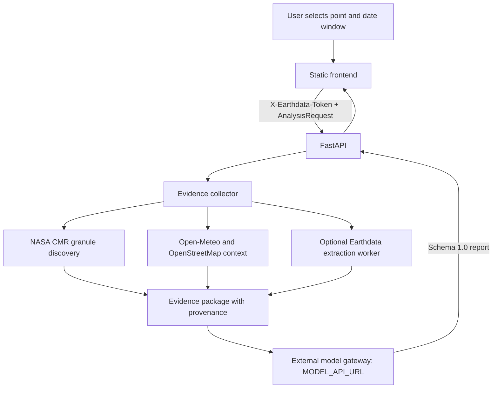

# Lupus Cortex: Repository Audit and Implementation Plan

## Audit scope and evidence

This audit is based on the current `main` branch README and inspected source files: `backend/app/main.py`, `backend/app/config.py`, `backend/app/schemas.py`, `backend/app/services/collector.py`, `backend/app/services/model_gateway.py`, `backend/app/collectors/nasa.py`, `backend/app/collectors/free_sources.py`, and `lupus cortex/indexDetails.js` / `dashboard.js`. Runtime behavior has not yet been executed in this audit.

## Existing architecture

The current repository separates evidence collection from model inference. The NASA collector discovers granules and metadata; numerical variable extraction is delegated to the optional `EARTHDATA_WORKER_URL`. The model gateway posts the evidence package to `MODEL_API_URL` and validates a minimum report schema. The frontend deliberately renders unavailable states rather than inventing model outputs.

## Verified component inventory

The frontend's `COMPONENT_META` defines exactly 30 component identifiers:

1. `PM2_5`
2. `PM10`
3. `NO2`
4. `O3`
5. `SO2`
6. `CO`
7. `AEROSOL_INDEX`
8. `LST`
9. `AIR_TEMP`
10. `REL_HUMIDITY`
11. `BUILTUP_PCT`
12. `IMPERVIOUS_PCT`
13. `NDVI`
14. `POP_DENSITY`
15. `VULNERABLE_AGE_PCT`
16. `GREEN_ACCESS_PCT`
17. `GREEN_SPACE_PCT`
18. `PRECIPITATION`
19. `EXTREME_RAINFALL`
20. `SOIL_MOISTURE`
21. `SURFACE_WATER_EXTENT`
22. `FLOOD_EXTENT`
23. `DROUGHT_SPI`
24. `ELEVATION_SLOPE`
25. `ROAD_DENSITY`
26. `TRANSPORT_ACCESS_PCT`
27. `HOSPITAL_ACCESS`
28. `CRIT_INFRA_DENSITY`
29. `NIGHT_LIGHTS`
30. `DISASTER_READINESS`

The frontend also defines nine domain indices: AQHI, UHVI, GEA, WSII, TAI, HAI, CRI, SCI, and DRI, plus the derived Human Wellbeing Index (HWI). Its current index detail describes equal-weight aggregation of direction-normalized component scores and fixed HWI domain weights. These frontend definitions are useful as the initial contract, but do not by themselves establish scientific validity of the score ranges or equal weights.

## Current capability assessment

| Capability | Status from source inspection | Notes |
|---|---|---|
| Geographic point and date-window request | Implemented in API schema | Latitude/longitude are range-validated. |
| NASA CMR discovery | Implemented in source | Catalog metadata and granule provenance, not numeric raster extraction. |
| Numeric NASA product extraction | External dependency | Requires `EARTHDATA_WORKER_URL`; not bundled in this repository. |
| Free contextual sources | Implemented in source | Open-Meteo, Nominatim and Overpass requests; outages are represented per source. |
| Trained RF/LSTM and ensemble | Not present in inspected runtime path | Analysis is delegated to external `MODEL_API_URL`. |
| Index mapping and labels | Frontend metadata exists | Must be made consistent with server-side, versioned methodology. |
| Reproducible fixed baseline | Not established by inspected files | Requires versioned, quality-controlled observations with spatial/temporal coverage. |
| Research/case-study retrieval | Not established by inspected files | Recommendation content currently arrives from the external model contract. |
| Automated tests and empirical metrics | Not verified | Must be run in a checkout/CI environment before claiming results. |

## Proposed model methodology

Do not claim that Random Forest is intrinsically temporal or an ordinary LSTM intrinsically spatial. Use Random Forest with explicit lagged, rolling, seasonal, trend and anomaly features. Use an LSTM only when the training set contains aligned, ordered sequences for each spatial unit or neighborhood. Encode spatial identity/context and preserve geographic grouping in validation. If adequate sequences are unavailable, report the LSTM as unavailable and do not fabricate predictions.

For compatible continuous targets, blend out-of-fold predictions using validation-only weights:

`\hat{y}=w_{RF}\hat{y}_{RF}+w_{LSTM}\hat{y}_{LSTM},\quad w_{RF}+w_{LSTM}=1,\quad w_i\ge0.`

Choose weights using training/validation folds only, minimizing a predeclared loss (for example, MAE). For classification, blend calibrated probabilities only when class definitions match. Keep a chronological final test period untouched. Add spatial or spatial-temporal holdouts to estimate geographic transfer. Compare persistence/seasonal-naive baseline, RF, LSTM and ensemble. Do not report metrics until evaluated against real labels.

## Data and scoring guardrails

- Keep raw observation, derived indicator, model estimate and forecast as distinct types.
- Store observation time, product version, units, quality flags, source URL/identifier and processing version.
- Select the latest valid observation at or before the requested due date for historical analysis; never leak future observations.
- Fit imputation, scaling and feature selection on training data only.
- Never substitute zero for unavailable observations without a documented scientific meaning.
- Keep the existing condition labels (81–100 Perfect; 61–80 Well managed; 41–60 Needs improvement; 21–40 Poor; 0–20 Harmful) only for scores whose direction and construction have been verified.
- Distinguish confidence in evidence from the magnitude of risk.
- Treat health and biodiversity implications as screening-level interpretations unless validated outcome data support stronger claims.

## Prioritized implementation sequence

1. Version the 30-component registry, source suitability, units, direction, cadence and quality requirements.
2. Define analysis-ready observation and provenance contracts; retain raster/grid formats when spatial structure matters.
3. Build a reproducible baseline from a documented historical period and version it explicitly.
4. Implement training-only feature engineering and temporal/spatial validation.
5. Train and compare simple baseline, Random Forest, sequence-capable LSTM and validation-weighted ensemble.
6. Integrate model inference behind the existing model gateway contract, with explicit unavailable states.
7. Move score normalization and index calculations to tested, versioned server-side logic.
8. Add evidence retrieval for recommendations with URL validation and source dates; keep it independent of inference.
9. Add fixtures and tests, run the suite/build, then report only measured results.

## Important limitations

This document records source-level findings, not a successful runtime test. The external numeric extraction worker, model service, NASA credentials, training labels and a validated historical dataset are not bundled by the inspected files. Live collection, model performance, Docker build, and scientific validity remain unverified until executed with suitable credentials and data.
